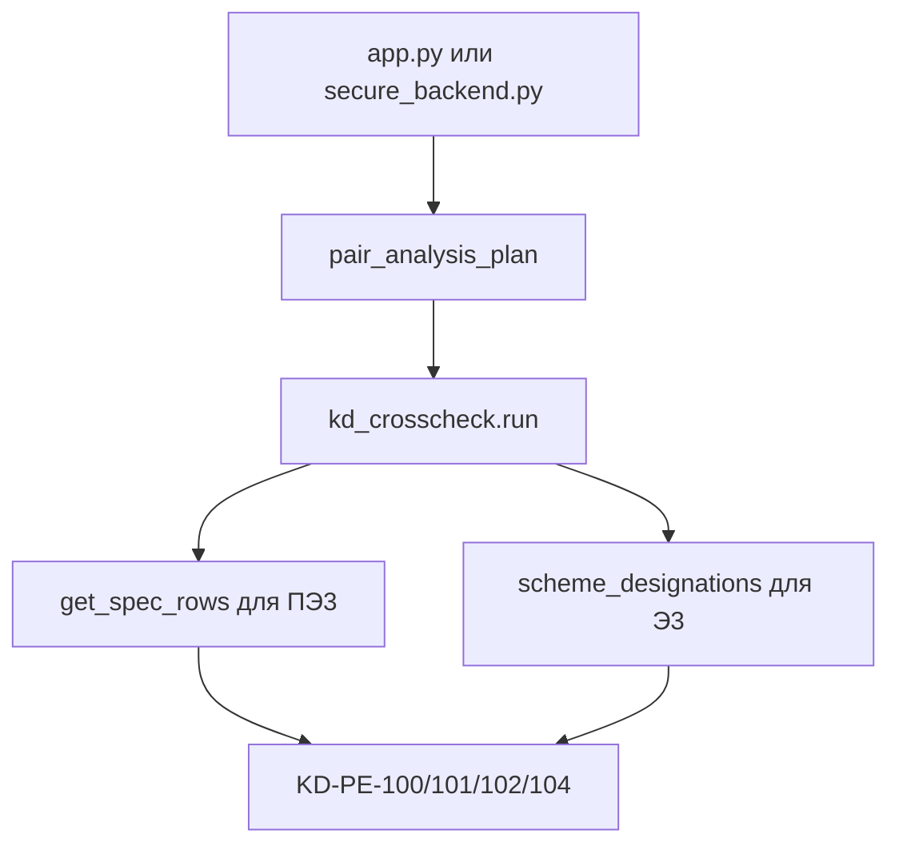

# KD-PE-105: позиционные обозначения Э3, отсутствующие в ПЭ3

Статус: **реализация подготовлена, синтетические проверки пройдены**. Ветка: `feature/e3-pe3-missing-designations` (база `316832131f1a759f3a61814537f04143c9e6ca84`). Проверка на реальных PDF не выполнена.

## 1. Фактическое состояние репозитория

| Параметр | Фактическое значение |
|---|---|
| Рабочая ветка | `feature/recovery` |
| Локальный HEAD `feature/recovery` | `d76ae72c5118dc0c0d7481b5d96eafd34bfef1da` |
| Контрольный коммит из задания | `316832131f1a759f3a61814537f04143c9e6ca84` — является предком текущего HEAD |
| Локальный `main` | `b97729e2451caad282240e181b959c70549a125f`, не изменялся |
| SourceCraft PR | №100, Draft, `feature/recovery` → `main` |
| GitHub PR | №99, Draft, `feature/recovery` @ `316832131f1a759f3a61814537f04143c9e6ca84` → `main` @ `b97729e2451caad282240e181b959c70549a125f` |
| CI-конфигурация GitHub | [`.github/workflows/tests.yml`](../.github/workflows/tests.yml) запускается только на `pull_request` в `main` |
| Зеркалирование GitHub | [`.sourcecraft/ci.yaml`](../.sourcecraft/ci.yaml) и [`tools/ci_publish_github_mirror.sh`](../tools/ci_publish_github_mirror.sh) жёстко нацелены на `feature/recovery` и `GITHUB_TARGET_SHA=316832131f1a759f3a61814537f04143c9e6ca84` |

Вывод: новая ветка создаётся от **фактического** HEAD `d76ae72…`, который содержит контрольный коммит `31683213…` и два CI-коммита сверху. История не переписывается.

## 2. Точки интеграции

Основной сценарий уже существует:



Новый код встраивается в [`kd_crosscheck.run()`](../kd_crosscheck.py:364), чтобы автоматически работать и в локальном MVP, и в защищённом parser worker:

- [`app.py`](../app.py:130) — локальная проверка пары;
- [`secure_backend.py`](../secure_backend.py:57) — защищённый backend и worker;
- [`parser_process.py`](../parser_process.py:265) — отдельный процесс, лимиты и валидация результата; для `KD-PE-105` добавляется проверка `details`;
- [`storage.py`](../storage.py:123) — история и решения инженера; JSON замечания сохраняет `details` без миграции SQLite;
- [`issue_tracking.py`](../issue_tracking.py:23) — fingerprint учитывает канонический `details` только при его наличии;
- [`excel_reports.py`](../excel_reports.py:43) — лист `Замечания` и 10 базовых колонок не меняются; при наличии `details` добавляются только колонки K/L;
- [`run_comparison.py`](../run_comparison.py:16) — сравнение проверок работает с новым fingerprint;
- [`static/index.html`](../static/index.html:26), [`static/report.css`](../static/report.css:20), [`secure_static/workbench.js`](../secure_static/workbench.js:15) и [`secure_static/workbench.css`](../secure_static/workbench.css:1) — карточки замечаний отображают `details` отдельным блоком.

Формат замечания сохраняет шесть обязательных полей:

`severity`, `code`, `file`, `location`, `message`, `recommendation`.

Только для `KD-PE-105` добавляется необязательное структурированное поле `details` (schema v1). Остальные коды сохраняют прежний формат. Это позволяет не дублировать полный список обозначений в `message`, сохраняет совместимость старых записей истории и требует точечного расширения валидатора worker, Excel/CSV и UI.

## 3. Новый модуль `e3_pe3_inventory.py`

Модуль не читает PDF самостоятельно. Он принимает уже извлечённые слова Э3 и уже разобранные строки ПЭ3. Это исключает повторный разбор файлов и упрощает тесты.

### 3.1. Внутренняя модель

- `Mention` — одно упоминание обозначения:
  - нормализованное обозначение;
  - исходное написание;
  - номер листа PDF;
  - тип контекста: `label`, `split_label`, `reference`, `note`, `table`, `unknown`;
  - короткий текстовый контекст;
  - координаты слова (внутреннее доказательство, в историю не пишутся).
- `SchemeComponent` — уникальный компонент Э3:
  - обозначение;
  - исходные написания;
  - листы PDF;
  - типы контекста;
  - уровень достоверности `high` / `medium` / `low`;
  - ограниченный набор упоминаний.
- `Comparison` — результат:
  - `status`: `evaluated` / `not_evaluated`;
  - причина;
  - отсутствующие компоненты;
  - совпавшие;
  - неоднозначные;
  - группы замечаний;
  - признаки ограничения (`truncated`, `partial`);
  - структурированный `details` schema v1 для каждого замечания.

### 3.2. Извлечение обозначений Э3

1. [`kd_crosscheck.run()`](../kd_crosscheck.py:364) обходит не более `MAX_PDF_PAGES = 100` страниц Э3.
2. Для каждой страницы один раз запрашиваются слова с координатами.
3. Новый модуль нормализует слово (латиница/кириллица, регистр) и ищет обозначения существующим `TAG`.
4. Контекст классифицируется:
   - `label` — отдельное слово-обозначение;
   - `reference` — `3TA2:И1`, строка соединений, ссылка на вывод;
   - `note` — примечание, ссылка на документ, таблица соответствия;
   - `table` — обозначение внутри диапазонной/табличной записи;
   - `split_label` — обозначение, восстановленное существующим `scheme_designations` из переноса строк;
   - `unknown` — недостаточно контекста.
5. Повторные упоминания одного компонента объединяются по нормализованному обозначению.
6. Клеммные контакты с суффиксом `.N` (`XT1.1`, `1SF1.8`) сравниваются по базовому устройству (`XT1`, `1SF1`), чтобы не создавать ложные отдельные компоненты.
7. Семьи `X`, `XT`, `XN`, `XL`, `XG` считаются клеммными: для них допускается только `info`, но не `warning`.

### 3.3. Извлечение обозначений ПЭ3

Используется существующий [`get_spec_rows()`](../kd_crosscheck.py:193), без дублирующего разбора:

- диапазоны раскрываются существующим `expand_notation`;
- поддерживаются `...`, `…`, `;`, переносы строк и несколько групп в одной ячейке;
- сохраняется исходная запись `source`;
- количество и признак `unknown` сохраняются;
- добавляется best-effort поле `name` (наименование позиции) из области между столбцом обозначений и столбцом количества; если наименование не извлечено достоверно, это явно указывается;
- добавляется признак `pdf_truncated`, если PDF содержит больше 100 страниц;
- строки без собственного позиционного обозначения не становятся новыми электрическими компонентами.

### 3.4. Сопоставление

1. `E3_components` — компоненты Э3 с достоверностью `high` или `medium`.
2. `PE3_components` — объединение раскрытых `entries` всех достоверных строк ПЭ3.
3. Точное сравнение нормализованных обозначений и базовых обозначений для суффиксов `.N`.
4. Для каждого отсутствующего обозначения ищется строка ПЭ3:
   - по семейству (`TA`, `KM`, `QF`, `XT`, …);
   - предпочтительно по совпадению группы (`1`, `2`, `3`, …);
   - предпочтительно по расхождению `quantity > len(entries)`.
5. Если строка не найдена или кандидатов несколько, замечание не становится категоричным: `info`.
6. Одно замечание формируется на группу «строка ПЭ3 + набор обозначений»; повторные упоминания на разных листах Э3 не создают дублей.

## 4. Формальная модель достоверности

### 4.1. Достоверность Э3

Для компонента `c`:

- `E3_conf(c) = high`, если есть хотя бы одно упоминание `label`;
- `E3_conf(c) = medium`, если есть `split_label` или `reference` на двух и более разных листах PDF;
- `E3_conf(c) = low` в остальных случаях (одна ссылка, только примечание, только таблица, `unknown`).

`label` считается сильным доказательством текстового присутствия, но не доказательством физического наличия. `reference` — потенциальное доказательство; одна ссылка недостаточна для предупреждения.

### 4.2. Достоверность строки ПЭ3

- `high` — существующий признак `duplicate_eligible` (полная сетка, границы ячейки, отсутствие `unknown`, точное написание диапазона);
- `medium` — `unknown` пуст, `entries` не пуст, количество числовое, `row_band` определён, и строка не выглядит одиночным обозначением при количестве больше 1;
- `low` — остальные случаи, включая неполный разбор и отсутствие границ строки.

### 4.3. Правило уровня

`warning` только если одновременно:

- `E3_conf` равен `high` или `medium`;
- строка ПЭ3 имеет `high` или `medium`;
- есть уникальная строка-кандидат;
- семейство не клеммное;
- либо `quantity > len(entries)`, либо строка ПЭ3 имеет `high`;
- нет `e3_truncated`, `pe3_truncated` и `partial`;
- для `medium`-доказательства Э3 требуется расхождение количества.

Иначе — `info`.

`not_evaluated` — отдельное информационное замечание, если:

- в Э3 нет ни одного текстового слова (скан без текстового слоя);
- в ПЭ3 не удалось достоверно извлечь ни одного обозначения;
- обработка ограничена так, что сравнение невозможно.

`error` не используется никогда.

## 5. Формат результата KD-PE-105

Код: `KD-PE-105`.

Название: «На схеме обнаружены обозначения, отсутствующие в перечне элементов».

Замечание сохраняет шесть обязательных полей и добавляет **только для KD-PE-105** необязательное структурированное поле `details`. Для остальных кодов формат не меняется.

### 5.1. Обязательные поля

| Поле | Содержание |
|---|---|
| `severity` | `warning` или `info`; `error` не используется |
| `code` | `KD-PE-105` |
| `file` | имя PDF ПЭ3 |
| `location` | краткое место: `Э3: листы PDF 1, 2; ПЭ3: лист PDF 2, строка таблицы 5` |
| `message` | краткая человекочитаемая сводка: заголовок, количество, первые 10 обозначений, документы, статус; полный список — в `details` |
| `recommendation` | рекомендация инженеру; первые 20 обозначений и возможный диапазон |

`message` не дублирует полный структурированный список и доказательства. Первые 10 обозначений нужны для читаемости карточки и CSV; полные данные находятся в `details`.

### 5.2. Схема `details` v1

```json
{
  "schema_version": 1,
  "kind": "e3_pe3_missing_designations",
  "status": "evaluated",
  "reason": "quantity_mismatch",
  "e3_document": "ТНБВ.656451.162.Э3.pdf",
  "pe3_document": "ТНБВ.656451.162.ПЭ3.pdf",
  "e3_pages": [1, 2],
  "pe3_page": 2,
  "pe3_table_row": 5,
  "pe3_row_band_pt": [70.0, 130.0],
  "pe3_page_size_pt": [600.0, 800.0],
  "pe3_quantity": 9,
  "pe3_entries_count": 7,
  "pe3_name": "Трансформатор тока измерительный ТТК-А-40/5А-5ВА-0,5S-УХЛ3",
  "pe3_name_confidence": "medium",
  "pe3_source": "1TA1...1TA3; 2TA1...2TA3; 3TA1",
  "type_family": "TA",
  "type_name": "трансформатор тока",
  "confidence": "high",
  "partial": false,
  "truncated": false,
  "missing": [
    {
      "designation": "3TA2",
      "raw": "3TA2",
      "pages": [1, 2],
      "kinds": ["label", "reference"],
      "evidence": [
        {"page": 1, "kind": "label", "context": "3TA2", "bbox_pt": [60.0, 90.0, 78.0, 96.0], "page_size_pt": [600.0, 800.0]},
        {"page": 2, "kind": "reference", "context": "3TA2:И1 - 3X1:3"}
      ]
    }
  ],
  "ambiguous": [],
  "limits": {
    "max_pages": 100,
    "max_listed": 1000,
    "truncated_list": false
  }
}
```

Ограничения схемы:
- `missing` — не более 1000 элементов; `evidence` — не более 3 на обозначение; `pages` — не более 10;
- строки: документы до 1000 символов, наименование/источник/контекст до 300 символов;
- общий размер `details` — не более 256 КиБ;
- при превышении списки усекаются, `limits.truncated_list=true`, а в `message` указывается количество показанных и общее количество;
- `bbox_pt`/`page_size_pt` и `pe3_row_band_pt`/`pe3_page_size_pt` необязательны; если координаты переданы, они должны быть конечными числами и лежать в границах страницы, иначе `details` отклоняется;
- неизвестные ключи, неверные типы, неотсортированные/повторяющиеся обозначения и страницы вне диапазона отклоняются валидатором.

Для `status="not_evaluated"`:
- `missing` пуст;
- `ambiguous` может содержать ссылочные/неоднозначные обозначения;
- `reason` — `no_text_layer`, `pe3_not_parsed`, `truncated`, `reference_only`, `ambiguous_row`;
- `severity` обязательно `info`.

Для `status="evaluated"`:
- `missing` может быть пустым только если замечание информационное и содержит `ambiguous`;
- `severity="warning"` допустим только при `confidence` `high`/`medium` и отсутствии `partial`/`truncated`.

### 5.3. Валидация в parser worker

[`parser_process._validate_result`](../parser_process.py:102) расширяется:
- `KD-PE-100` по-прежнему может иметь `evidence` (schema v1, result_version 2);
- `KD-PE-105` обязан иметь `details` и не может иметь `evidence`;
- остальные коды не могут иметь ни `details`, ни `evidence`;
- [`valid_details()`](../e3_pe3_inventory.py) проверяет схему, типы, границы, координаты, документы из `known_files`, типы `.Э3`/`.ПЭ3`, совпадение `pair_key`, `issue['file'] == details['pe3_document']` и согласованность `severity`/`status`.

### 5.4. Отображение и экспорт

- [`static/index.html`](../static/index.html:26) и [`secure_static/workbench.js`](../secure_static/workbench.js:15) добавляют блок «Структурированные сведения»:
  - отсутствующие обозначения;
  - листы Э3 и контексты;
  - лист/строка ПЭ3;
  - количество и раскрытые обозначения;
  - наименование ПЭ3;
  - уровень достоверности;
  - статус `evaluated`/`not_evaluated`.
- Полный список в UI ограничивается 200 обозначениями с указанием, что полный список — в Excel; это защита DOM, а не потеря данных.
- Excel: используется существующий лист `Замечания`. Для запусков без `details` его 10 колонок не меняются. Если хотя бы у одного замечания есть `details`, после колонки J добавляются две аддитивные колонки: `Доказательства KD-PE-105` (человекочитаемый список обозначений, листов, контекстов, количества и достоверности) и `Детали KD-PE-105 (JSON)` (компактный JSON schema v1). Для остальных замечаний эти колонки пусты. Отдельный лист на каждое замечание не создаётся.
- CSV: строго шесть существующих колонок. Полные структурированные доказательства в CSV не выводятся; человекочитаемые описание и рекомендация остаются в `message` и `recommendation`, включая первые 10 обозначений.
- История: SQLite-схема не меняется; `details` хранится внутри JSON замечания. Старые записи читаются без миграции.
- [`issue_tracking.finding_identity()`](../issue_tracking.py:23) включает канонический JSON `details` только при его наличии; старые замечания без `details` сохраняют прежний fingerprint.

## 6. Обработка сложных ситуаций

| Ситуация | Решение |
|---|---|
| Повтор на нескольких листах Э3 | Объединение по нормализованному обозначению; один компонент |
| Несколько контактов устройства | Сравнение по базовому обозначению; `.N` не создаёт новый компонент |
| Только запись соединения | `reference`; одна ссылка — `low`, не warning |
| Примечание или ссылка на документ | `note`; только `info` |
| Таблица соответствия | `table`/`note`; только `info` |
| Кириллица/латиница | Нормализация существующим `normalized`; исходное написание сохраняется |
| Перенос диапазона ПЭ3 | Существующий `get_spec_rows` и `expand_notation` |
| `...`, `…`, `;` | Существующий `expand_notation` |
| Похожие обозначения | Только точное нормализованное совпадение; без нечёткого поиска |
| Несколько групп в строке | Раскрытие в множество; привязка по семейству/группе |
| Разные редакции | `pair_analysis_plan` пропускает неоднозначную пару; KD-PE-105 не создаётся |
| Только Э3 или только ПЭ3 | Пара не создаётся; KD-PE-105 не создаётся |
| Скан без текста | `not_evaluated`; отсутствие не утверждается |
| Повреждённый/неполный текст | `not_evaluated` или `info` с ограничением |
| Клеммник и номер клеммы | База `XT1`; клеммное семейство — только `info` |
| Диапазон в ПЭ3 и несколько мест в Э3 | Дедупликация; совпадение по множеству |
| Одинаковые номера в разных группах | Группа и семейство сохраняются; `1TA1`, `2TA1`, `3TA1` различны |
| Вспомогательное изделие без обозначения | Не становится компонентом ПЭ3 |
| Часть схемы в другом документе | Нет строки-кандидата — только `info` |
| Ограничение PDF | `partial`/`truncated`; уровень понижается до `info` |

## 7. Тестирование

Новый файл: `tests/test_e3_pe3_inventory.py`.

Обязательные сценарии:

- **A. Контрольный случай**: Э3 — 9 трансформаторов; ПЭ3 — `1TA1...1TA3; 2TA1...2TA3; 3TA1`, количество 9. Ожидаются `KD-PE-102` и `KD-PE-105` с `3TA2`, `3TA3`.
- **B. Исправленный ПЭ3**: `...3TA1...3TA3`, количество 9. `KD-PE-105` и `KD-PE-102` отсутствуют.
- **C. Повторение**: `3TA2` встречается 10 раз; один уникальный компонент, одно замечание.
- **D. Только ссылка**: `3TA2:И1 - 3X1:3`; без категоричного warning, только `info`/`not_evaluated`.
- **E. Скан**: Э3 без текстового слоя; `KD-PE-105` в статусе `not_evaluated`, без списка отсутствующих.
- **F. Регрессия**: все существующие тесты проходят; обновляются только точные списки кодов, где законно появился `KD-PE-105`.

Дополнительно проверяется структурированный контракт:

- `details` присутствует у каждого `KD-PE-105` и отсутствует у остальных кодов;
- `valid_details()` отклоняет неизвестные ключи, неверные типы, слишком длинные строки, лишние элементы, неверные документы, несовпадение `pair_key`, несогласованные `severity`/`status` и координаты вне границ страницы;
- `parser_process._validate_result` принимает корректный `KD-PE-105` с `details` и отклоняет `KD-PE-105` без `details`, с `evidence` или с повреждённым `details`;
- Excel сохраняет лист `Замечания` и 10 базовых колонок; при наличии `details` добавляет колонки K/L с человекочитаемыми доказательствами и JSON, не создавая лист на каждое замечание;
- CSV всегда остаётся строго 6-колоночным; структурированные доказательства доступны в UI, Excel и API;
- `finding_identity()` старых замечаний не меняется, а новые замечания с разными `details` различаются;
- UI показывает отсутствующие обозначения, листы, контексты, достоверность и статус без DOM-инъекций.

Дополнительные отрицательные и граничные сценарии:

- смешанные латинские/кириллические обозначения;
- переносы и варианты диапазонов;
- несколько групп в одной строке ПЭ3;
- клеммники и контакты `.N`;
- вспомогательная строка без обозначения;
- разные редакции и неполная пара;
- примечание/таблица соответствия;
- ограничение 100 страниц;
- длинный список отсутствующих обозначений и ограничение длины сообщения;
- отсутствие ложных дублей при повторных ссылках.

Ожидаемые изменения существующих тестов:

- [`tests/test_pdf_normalization.py`](../tests/test_pdf_normalization.py:115) — контрольный сценарий 9 против 7 теперь ожидает `KD-PE-105`.
- [`tests/test_pe3_duplicates.py`](../tests/test_pe3_duplicates.py:208) — тот же сценарий через API: `warning=2`, `info=1`.
- [`tests/test_rule_evidence_catalog.py`](../tests/test_rule_evidence_catalog.py:17) — в список источников добавляется `e3_pe3_inventory.py`.
- [`quality/rule_catalog.py`](../quality/rule_catalog.py:27) — регистрируется `KD-PE-105`.

## 8. Изменяемые файлы

Новые:

- `e3_pe3_inventory.py` — извлечение упоминаний, модель достоверности, сопоставление, `details` schema v1 и `valid_details()`;
- `tests/test_e3_pe3_inventory.py` — контрольный и граничные сценарии;
- `tests/test_e3_pe3_details.py` — валидация `details` и parser worker;
- `tests/test_e3_pe3_ui.py` — браузерная проверка блока структурированных сведений;
- `docs/e3-pe3-missing-designations.md` — алгоритм, достоверность и ограничения;
- `docs/e3-pe3-details-schema.md` — формальная схема `details` v1, Excel K/L, CSV 6 колонок и UI mapping;
- `plans/e3-pe3-missing-designations.md`;
- `plans/draft-pr-body-e3-pe3.md`;
- `plans/e3-pe3-final-report.md` (шаблон итогового отчёта).

Изменяемые:

- `kd_crosscheck.py` — ограниченный обход страниц, `name`/`pdf_truncated`, сбор упоминаний, интеграция `KD-PE-105`;
- `parser_process.py` — allowlist `details` только для `KD-PE-105` и вызов `valid_details()`;
- `issue_tracking.py` — канонический `details` в fingerprint только при наличии;
- `excel_reports.py` — аддитивные колонки K/L на существующем листе `Замечания` только при наличии `details`; отдельные листы не создаются;
- `static/index.html`, `static/report.css` — блок структурированных сведений;
- `secure_static/workbench.js`, `secure_static/workbench.css` — блок структурированных сведений;
- `quality/rule_catalog.py` — регистрация кода;
- `tests/test_rule_evidence_catalog.py` — источник нового кода;
- `tests/test_pdf_normalization.py` — контрольный сценарий;
- `tests/test_pe3_duplicates.py` — сценарий через API;
- `tests/test_excel_reports.py` — колонки K/L при наличии `details`, сохранение старых 10 колонок и строгих 6 колонок CSV;
- `tests/test_issue_management.py` — fingerprint с `details` и без него;
- `tests/test_issue_ui.py` — отображение структурированных сведений;
- `README.md` — описание правила, `details`, Excel/CSV и ограничений;
- `docs/parallel-development-acceptance-plan.md` — место KD-PE-105 в матрице;
- `docs/ambiguous-pdf-pairs.md` — упоминание, что KD-PE-105 пропускается для неоднозначной пары.

Не изменяются:

- `main`, Supabase, EPLAN Checklist, production-данные;
- `.sourcecraft/ci.yaml`, `.github/workflows/tests.yml`;
- формат SQLite; шесть обязательных полей замечания сохраняются, `details` — только additive JSON для `KD-PE-105`;
- лимиты parser worker и изоляция процессов;
- реальные PDF предприятия в репозиторий не добавляются.

## 9. Git, PR и CI

Порядок:

1. `git status --porcelain` — при наличии незакоммиченных изменений остановиться.
2. `git rev-parse HEAD`, `git rev-parse feature/recovery`, `git rev-parse main` — зафиксировать SHA.
3. `git switch -c feature/e3-pe3-missing-designations feature/recovery`.
4. Реализация, тесты, документация.
5. Коммит без amend/rebase: `feat: detect E3 designations missing from PE3 (KD-PE-105)`.
6. `git push -u origin feature/e3-pe3-missing-designations` — только SourceCraft `origin`.
7. Создать **Draft PR в SourceCraft**: `feature/e3-pe3-missing-designations` → `feature/recovery`, `publish=false`.
8. Проверить PR через SourceCraft API: статус Draft, head SHA, base SHA.
9. Не создавать и не изменять GitHub PR #99; не выполнять merge; не менять `main`.

CI:

- GitHub Actions в этом репозитории запускается только на `pull_request` в `main`.
- SourceCraft PR в `feature/recovery` не запускает GitHub Actions.
- Существующий mirror workflow жёстко нацелен на `feature/recovery` и `316832131f1a759f3a61814537f04143c9e6ca84`; он не публикует новую ветку.
- Поэтому Windows/Linux CI для новой ветки **не может быть подтверждён** в рамках текущих доступов. Это будет явно указано как блокер, а не как пройденная проверка.
- Локально будут выполнены целевые тесты и полный `python -m pytest -q` (с фактическими pass/skip/fail). Windows-приёмка останется ручным шагом.

## 10. Блокеры и ограничения

1. **Реальные PDF не предоставлены агенту.** Контрольный пример будет проверен на синтетических PDF. Реальная приёмка на `ТНБВ.656451.162.Э3` / `ПЭ3` не может быть объявлена пройденной без фактического запуска.
2. **Windows/Linux CI новой ветки не запускается** в текущей схеме зеркалирования. Это блокер критериев 11–12 до отдельного решения владельца.
3. **GitHub Draft PR не создаётся.** Будет создан SourceCraft Draft PR; платформа будет указана явно. GitHub PR #99 не затрагивается.
4. **Текстовый слой PDF.** Правило не является OCR и не доказывает физическое отсутствие элемента. Оно фиксирует текстовое расхождение.
5. **Наименование ПЭ3** извлекается best-effort; при неудаче в замечании будет указано, что наименование не распознано достоверно.
6. **Клеммные семейства** на первом этапе не дают warning, чтобы не создавать ложные срабатывания по клеммникам.
7. **Ограничение 100 страниц** согласовано с существующим лимитом PDF; при превышении результат понижается до `info`/`not_evaluated`.

## 11. Критерии приёмки

- [ ] Новый модуль реализован и детерминирован.
- [ ] `KD-PE-105` зарегистрирован в каталоге правил.
- [ ] Правило интегрировано в `kd_crosscheck.run()` для локального и защищённого сценариев.
- [ ] `details` schema v1 формируется и строго валидируется в parser worker.
- [ ] `KD-PE-105` без `details` или с `evidence` отклоняется worker.
- [ ] Синтетический контрольный пример даёт `3TA2`, `3TA3` в `details.missing`.
- [ ] Исправленный ПЭ3 убирает `KD-PE-105`.
- [ ] Ссылочные и неполные доказательства не дают warning.
- [ ] Нет ложных дублей при повторных упоминаниях.
- [ ] `KD-PE-100`–`KD-PE-104` сохраняют поведение.
- [ ] История, решения, CSV, Excel и сравнение работают.
- [ ] Excel сохраняет лист `Замечания`; при наличии `details` добавлены только колонки K/L, отдельные листы не создаются.
- [ ] CSV строго 6 колонок для всех запусков; структурированные доказательства доступны в UI, Excel и API.
- [ ] `details` содержит координаты, если они доступны, и валидирует их границы.
- [ ] UI отображает структурированные сведения без DOM-инъекций.
- [ ] `finding_identity()` старых замечаний не изменился.
- [ ] Целевые и полные локальные тесты выполнены; результаты зафиксированы.
- [ ] Windows/Linux CI: явно указан фактический статус; при невозможности запуска — блокер.
- [ ] Изоляция парсеров и лимиты не ослаблены.
- [ ] Документация и ограничения подготовлены.
- [ ] Создан SourceCraft Draft PR; GitHub PR не заявлен.
- [ ] `main` и production не изменены.

## 12. Итоговый отчёт

Шаблон [`plans/e3-pe3-final-report.md`](e3-pe3-final-report.md) заполняется после реализации:

1. ссылка на ветку SourceCraft;
2. ссылка на Draft PR и платформа;
3. базовый и итоговый SHA;
4. изменённые файлы;
5. алгоритм;
6. модель достоверности;
7. фактический пример `KD-PE-105` и его `details` JSON;
8. количество passed/skipped/failed;
9. Windows/Linux CI — факт или блокер;
10. подтверждение отсутствия регрессий;
11. ограничения;
12. незавершённые вопросы;
13. инструкция ручной приёмки на Windows 11;
14. подтверждение, что `main` и production не изменены.
