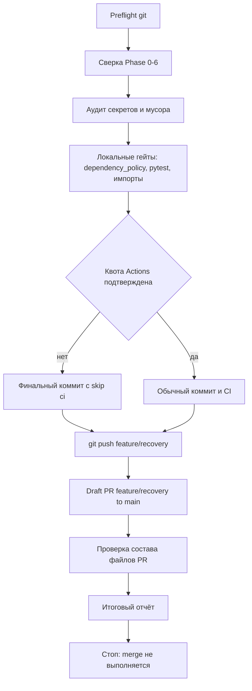

# План публикации `feature/recovery` в GitHub

Статус: **план, реализация не начата**. Работа ограничена веткой
`feature/recovery` и одним Draft PR в `main`.
Источник фактов: [`plans/recovery-progress.md`](recovery-progress.md).

## Предпосылки и ограничения

| Пункт | Значение |
|-------|----------|
| Целевой репозиторий | `stammendr1510-oss/KD-Checker` (зеркало SourceCraft `stammendrs1510/kd-checker`) |
| База `main` | `b97729e2451caad282240e181b959c70549a125f` |
| Ветка | `feature/recovery` |
| Merge в `main` | запрещён до независимой приёмки |
| Вне области | `main`, Supabase, EPLAN Checklist, производственные данные, Render PR #95–#98 |
| Существующий PR из `feature/recovery` | не найден (проверено по всем статусам) |
| CI-триггер | `.github/workflows/tests.yml` — только `pull_request: [main]`, без фильтра `types` |

Следствие по CI: создание Draft PR само по себе запускает 2 задания
(`ubuntu-latest`, `windows-latest`). Если квота Actions не подтверждена,
финальный коммит HEAD ветки должен содержать `[skip ci]`, иначе квота будет
израсходована публикацией.

## Схема процесса



## Шаг 1. Preflight git-состояния

```bash
git rev-parse --show-toplevel
git status -sb
git branch -a
git remote -v
git log --oneline -n 40
git rev-parse main feature/recovery
git log --merges --oneline origin/main..feature/recovery | wc -l
```

Контроль:

- `main` локально и в `origin` = `b97729e`.
- Текущая ветка — `feature/recovery`, рабочее дерево без изменённых
  runtime-файлов.
- В `.git` присутствуют все merge-коммиты фаз (см. таблицы в
  [`plans/recovery-progress.md`](recovery-progress.md)).

## Шаг 2. Сверка состава Phase 0–6

Ожидаемо восстановлены 53 PR:

| Фаза | PR |
|------|----|
| 1 | 83, 72, 46, 57, 38, 37, 48, 39, 23, 44 |
| 2 | 40, 41, 82, 54, 88, 90 |
| 3 | 45, 55, 56, 75, 76, 77, 58, 64, 66 |
| 4 | 52, 59, 60, 61, 62, 63, 74 |
| 5 | 47, 65, 67, 68, 69, 70, 71, 73, 78, 79 |
| 6 | 80, 81, 84, 85, 86, 87, 92, 93, 94, 89, 91 |

Вне ветки осознанно остаются #42, #43, #49, #50, #51, #53 и Render #95–#98.

Если рабочее дерево грязное — коммитить только исходники, тесты,
документацию и планы; ничего из `.venv`, `.pytest_cache`, `data/`,
`__pycache__`, локальных БД и временных выгрузок.

## Шаг 3. Аудит секретов и мусора

```bash
git ls-files | grep -Ei '(^|/)(\.env|\.env\.|.*\.pem|.*\.key)$|token|secret|password|credential' || echo "clean"
git ls-files | grep -Ei '\.(sqlite3?|db|bak|tmp|log)$' || echo "clean"
git ls-files | grep -Ei '\.(pdf|xlsx|xlsm|dxf|dwg|csv)$' || echo "no binary docs"
git status --ignored --porcelain
git check-ignore -v .venv .pytest_cache data/history.sqlite3
```

Допустимы только синтетические фикстуры из `tests/fixtures/`.
Реальные документы предприятия, `.env`, токены, пароли и локальные базы
в индекс попасть не должны.

## Шаг 4. Артефакты Phase 0

Проверить наличие и отслеживание `.gitignore`, `.gitattributes`,
`pyproject.toml`, `plans/`, `docs/stabilization-baseline.md`.
При отсутствии — восстановить из `chore/stabilization-bootstrap` (`6a652cc`)
отдельным коммитом в `feature/recovery`.

## Шаг 5. Локальные гейты

```bash
.venv/bin/python tools/dependency_policy.py
.venv/bin/python -m pytest -q --ignore=tests/test_issue_ui.py
.venv/bin/python -c "import secure_api, secure_sessions, secure_backend, durable_sessions, connection_checks, connection_import, body_budget, project_configuration, parser_process, parser_capacity, synthetic_stand, source_identity, pdf_match_evidence, run_provenance, full_set_completeness; print('imports ok')"
sha256sum storage.py config.json app.py
```

Ожидаемые ориентиры: `dependency_policy` — passed;
`909 passed, 1 skipped, 1 warning`; импорты — ok; SHA-256 `storage.py`,
`config.json`, `app.py` совпадают с `4bb40ce…`, `1c137bc…`, `de17ec3…`.

Браузерный `tests/test_issue_ui.py` запускать только при установленном
Playwright Chromium; иначе зафиксировать как ограничение окружения (F3).

## Шаг 6. Публикация

```bash
git push --dry-run origin feature/recovery
git push -u origin feature/recovery
git rev-parse HEAD
```

Создание Draft PR (вариант A — `gh`):

```bash
gh pr create --draft --base main --head feature/recovery \
  --title "Recovery: Phase 0-6 integration of 53 PRs [skip ci]" \
  --body-file plans/draft-pr-body.md
```

Вариант B — SourceCraft MCP: `CreatePullRequest` с `publish=false`,
`source_branch=feature/recovery`, `target_branch=main`.
После создания убедиться, что PR виден в GitHub.

Запрещено: `MergePullRequest`, `PublishPullRequest`, любые операции с
`main`, Supabase, EPLAN Checklist и производственными данными.

## Шаг 7. Итоговый отчёт

Отчёт содержит:

1. Ссылку на Draft PR.
2. SHA финального коммита `feature/recovery`.
3. Перечень 53 восстановленных PR по фазам.
4. Число passed / failed / skipped тестов и результат `dependency_policy`.
5. Нерешённые ошибки и ограничения: CI не подтверждён, Starlette/httpx
   warning, optional staging skip, браузерные тесты зависят от Chromium,
   Render-демо вне ветки, design-only пункты (#21 и др.).
6. Готовность пяти инженерных контуров КД.
7. Список функций к следующей разработке.

## Критерии остановки

- Ветка `feature/recovery` опубликована, Draft PR создан или обновлён.
- `main` не изменён, merge не выполнен.
- Секреты и производственные данные не опубликованы.
- Отчёт передан; дальнейшие действия — только после независимой приёмки.
