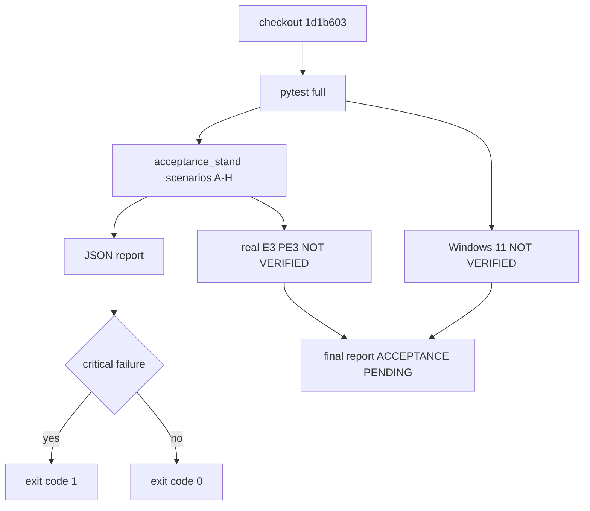

# KD-PE-106 — план независимой инженерной приёмки KD Checker

Статус: **PLAN ONLY**. Код не изменялся, тесты в этой сессии не запускались.
Итоговый статус продукта на текущий момент: `ACCEPTANCE PENDING`.

## 1. Главный вопрос приёмки

Можно ли текущей версией KD Checker самостоятельно выполнять предварительную
проверку реальных Э3 и ПЭ3 перед выпуском КД — так, чтобы инженер мог доверять
как найденным несоответствиям, так и отсутствию замечаний.

Ответ не может быть получен только чтением кода: нужен воспроизводимый прогон
тестов, синтетический инженерный стенд, фактический запуск на Windows 11 и
проверка контрольных реальных комплектов.

## 2. Подтверждённое исходное состояние

Проверено через GitHub API в этой сессии (не по прежним отчётам).

| Параметр | Значение | Как проверено |
|---|---|---|
| Репозиторий | `stammendr1510-oss/KD-Checker` | `GET /repos/...` |
| PR #101 | существует, `state=open`, `draft=true`, `mergeable_state=clean` | `GET /pulls/101` |
| Head PR | `feature/kd-pe-105-acceptance` @ `1d1b603cae14f2adba8c043e85404e239aae4d96` | `GET /pulls/101` |
| Base PR | `feature/e3-pe3-missing-designations` @ `a968ef8d533281369dfecdc99df6615cba771e24` | `GET /pulls/101` |
| Объём PR | 6 коммитов, 33 файла, `+6212 / -155` | `GET /pulls/101` |
| CI для `1d1b603` | `total_count = 0`, статусов нет | `GET /commits/1d1b603.../status` |
| Локальная ветка-цель | `feature/kd-pe-105-acceptance` существует локально на `1d1b603` | `.git/logs/refs/heads/...` |
| Текущий checkout | `ci/publish-kd-pe-105-github` (ветка публикации, **без** кода KD-PE-105) | `.git/HEAD`, листинг дерева |
| Код KD-PE-105 в рабочем дереве | **отсутствует** (`identifier_classification.py` и др. не найдены) | поиск по `*.py` |
| След прошлых прогонов | `.pytest_cache/lastfailed` содержит 3 упавших node id | `.pytest_cache/v/cache/lastfailed` |

Вывод по этапу 1: исходная точка достоверна, но рабочее дерево сейчас **не
соответствует** проверяемому кандидату. До любых измерений нужно переключение
на `1d1b603` и чистая новая ветка `feature/kd-pe-106-engineering-acceptance`
от этого коммита.

`.pytest_cache/lastfailed` (требует перепроверки, не является доказательством):

- `tests/test_kd_pe_105_diagnostics.py::test_km_quantity_one_with_duplicate_evidence_is_ambiguous_row_and_high`
- `tests/test_kd_pe_105_diagnostics.py::test_equal_scored_rows_are_reported_as_no_matching_pe3_row`
- `tests/test_e3_pe3_row_matching.py::test_end_to_end_comma_and_wrapped_pe3_keeps_ta_control`

Это ровно те сценарии, где ожидания тестов могут конфликтовать с новым
валидатором `ambiguous_row`. Приоритет перепроверки — P0 по достоверности
отчёта: заявленные `1080 passed` должны быть подтверждены на этом SHA.

## 3. Ограничения текущей среды

| Ограничение | Следствие |
|---|---|
| SourceCraft работает в Linux-контейнере | Windows 11: **NOT VERIFIED**, без вариантов |
| В режиме Architect нет инструмента выполнения команд | нельзя `git switch`, `pytest`, `pip` — измерения выполняются в Code |
| Architect может изменять только `*.md` | код, тесты и инструменты — только в Code |
| Нет реальных Э3/ПЭ3 и XLSX-отчёта | Этап 7: **NOT VERIFIED**, только методика |
| GitHub Actions на stacked PR не запускается | внешнее подтверждение CI отсутствует, фиктивный статус не создаётся |

Ни одно из этих ограничений не отменяет остальные проверки; каждое фиксируется
в итоговом отчёте явно.

## 4. Статический аудит кода кандидата (что уже видно)

Прочитаны `identifier_classification.py` и `kd_pe_105_confidence.py` на `1d1b603`.
Модель достоверности построена корректно в главном: правило минимума, без
числовых весов, `high` невозможно при `partial`/`truncated`, неоднозначной
строке или отсутствии строки, количество обозначений не повышает уверенность.

Гипотезы дефектов (не подтверждены запуском, требуют теста):

| ID | Приоритет | Гипотеза | Проверка |
|---|---|---|---|
| H-01 | P0 | Заявленные `1080 passed` не воспроизводятся на `1d1b603` (есть 3 упавших node id в кэше) | полный и целевой pytest |
| H-02 | P1 | `validate_combination()` запрещает `reason=ambiguous_row`, но старые тесты/потребители могут его ожидать | поиск производителей `ambiguous_row`, запуск тестов диагностики |
| H-03 | P2 | `CROSS_REF_RE` включает `лист`, `табл`, `прим`, `поз` — строка с таким словом переводит **самостоятельное** изделие в `cross_reference`, подавляя законное замечание | синтетический тест: `QF1` в строке с `Примечание` |
| H-04 | P2 | `_occurrence_end()` ищет **первое** вхождение токена в строке, поэтому вывод может быть привязан не к тому вхождению | тест с двумя вхождениями в одной строке |
| H-05 | P2 | `kind in (note, table, unknown)` даёт `ambiguous` только если раньше не сработал `CROSS_REF_RE` — порядок правил делает поведение в таблицах непредсказуемым | тест Scenario F, табличные обозначения |
| H-06 | P2 | Warning допускается при `pe3_extraction=medium` (строка без подтверждённой полосы PDF-сетки) | тест: `quantity_mismatch` без `row_band` |
| H-07 | P3 | `family_of()` и правило `X` — единственная жёсткая привязка к семейству; `XT1` при `kind=label` остаётся `device_candidate`, что верно, но требует явного теста на `X1`/`XT1` | тесты Scenario E |
| H-08 | P3 | `_clean()` усекает контекст до 300 символов без маркера усечения | проверка текста доказательства |

Отдельно: `no_matching_pe3_row` для `X1` при `kind=label` — **осознанное
ограничение**, а не дефект. Повышение до `warning` без инженерного правила
запрещено заданием; в плане оно не выполняется.

## 5. Работы по этапам задания

### Этап 1 — фиксация исходной точки

1. `git switch feature/kd-pe-105-acceptance` → `git rev-parse HEAD` = `1d1b603…`.
2. `git switch -c feature/kd-pe-106-engineering-acceptance`.
3. `git status --short` — пусто; незакоммиченные изменения не перезаписывать.
4. Зафиксировать `python --version`, `pip freeze`, версии зависимостей.

### Этап 2 — автоматические проверки

```text
python tools/dependency_policy.py
python -m pytest -q
python -m pytest -q tests/test_identifier_classification.py \
  tests/test_kd_pe_105_confidence_model.py tests/test_kd_pe_105_evidence.py \
  tests/test_e3_pe3_row_matching.py tests/test_kd_pe_105_diagnostics.py \
  tests/test_e3_pe3_inventory.py tests/test_e3_pe3_details.py
```

Протокол: ОС, Python, зависимости, passed/failed/skipped, warning, длительность.
`failed` не скрывать и не исключать. Расхождение с `1080 passed, 1 skipped`
объяснять, а не замалчивать.

### Этап 3 — независимый инженерный стенд (сценарии A–H)

Новый модуль `acceptance_stand.py` + `tests/test_kd_pe_106_acceptance.py`
(без дублирования `synthetic_stand.py`, с переиспользованием его генераторов
PDF). На каждый сценарий: вход, ожидание, факт, машинный критерий, инженерное
обоснование, ссылка на тест.

- A корректный комплект → нет ложных warning;
- B отсутствие в ПЭ3 → warning с доказательством;
- C лишняя позиция ПЭ3 → границы правила, нет ложной ошибки;
- D дубли: устройство, контакт, разные листы, законные повторные ссылки;
- E `X1`, `XT1`, `SF1`, `QF1`, `K1`, `KA1`, `KM1`, `HL1`, `SB1`;
- F регистр, пробелы, дефисы, похожие символы, кириллица/латиница, индексы;
- G пустой/битый файл, XLSX, PDF без текста, отсутствие документа → нет
  ложного «успешно проверено»;
- H многолистовые схемы, ссылки между листами, неполный комплект листов.

### Этап 4 — аудит модели достоверности

Таблица по каждой категории: входные данные, основание, условия `info` /
`warning` / (`error` — контрактом не предусмотрен), свидетельства, риск FP,
риск FN. Проверить, что `high` не выводится из совпадения текста и что UI не
подаёт эвристику как вероятность.

### Этап 5 — представление результата инженеру

Проверить карточку результата, переход к документу/листу/строке/обозначению,
текст доказательств, экспорт CSV/XLSX, историю и решения. Править только
подтверждённые дефекты, не переписывая работу Codex над интерфейсом.

### Этап 6 — Windows 11

Фактической среды нет → `NOT VERIFIED`. Артефакты:
`docs/kd-pe-106-windows11-test-plan.md` и
`tools/windows11_acceptance.ps1` с проверкой SHA, venv, зависимостями, полным
pytest, `synthetic_stand.py accept`, запуском `start_windows.bat`, проверкой
`http://127.0.0.1:8765`, выгрузкой отчёта, повторным запуском, сохранением
журналов и строгим ненулевым кодом при провале.

### Этап 7 — реальные Э3/ПЭ3

Документов нет → `NOT VERIFIED`. Артефакты: методика ручной приёмки,
шаблон регистра дефектов, таблица «ожидаемое / фактическое», перечень нужных
примеров (корректный комплект, комплект с известными дефектами, многолистовой
комплект, PDF без текстового слоя).

### Этап 8 — реестр и исправления

Исправлять только подтверждённые P0–P2, каждый — с регрессионным тестом.
Инженерные правила не менять ради зелёного теста. Спорные случаи выносить в
открытые вопросы.

### Этап 9 — оценка готовности

Семь направлений + готовность к нескольким ПК, статусы `CONFIRMED` /
`PARTIAL` / `NOT VERIFIED` / `BLOCKED` без процентов.

### Этап 10 — повторяемая приёмка

Единая команда `python acceptance_stand.py --json report.json`, детерминизм,
ненулевой exit code при критическом сбое, `NOT VERIFIED` не превращается в
`PASS`, отчёт разделяет pass / defect / not_verified.

### Этапы 11–12 — документы и публикация

`docs/kd-pe-106-engineering-acceptance.md`,
`docs/kd-pe-106-windows11-test-plan.md`,
`docs/kd-pe-106-diagnostic-quality.md`,
`docs/kd-pe-106-known-limitations.md`,
`plans/kd-pe-106-final-report.md`; коммит, публикация ветки, Draft PR
`KD-PE-106: Independent Engineering Acceptance and Windows 11 Validation`
(head `feature/kd-pe-106-engineering-acceptance`, base
`feature/kd-pe-105-acceptance`). Merge не выполняется.

## 6. Схема повторяемой приёмки



## 7. Предварительная матрица готовности

| Направление | Предварительный статус | Основание |
|---|---|---|
| 1. Обозначения компонентов и устройств | PARTIAL | классификатор есть, сценарии E/F не проверены запуском |
| 2. Схемы и спецификации Э3/ПЭ3 | PARTIAL | сопоставление реализовано, реальные документы не проверены |
| 3. Соединения, кабели, клеммы | NOT VERIFIED | в кандидате только текстовые эвристики, топологии нет |
| 4. Дубли | PARTIAL | `KD-PE-104` есть, многолистовые случаи не подтверждены |
| 5. ЕСКД/ГОСТ | NOT VERIFIED | нормативных правил в кандидате нет |
| 6. Комплектность | PARTIAL | `KD-SET-*` есть, листность намеренно не реализована |
| 7. Согласованность комплекта | PARTIAL | междокументные проверки эвристические |
| Несколько ПК предприятия | NOT VERIFIED | нет auth/RBAC в runtime, gates не выполнены |

## 8. Критерии завершения блока SourceCraft

Блок считается выполненным как работа, если: аудит выполнен, стенд A–H создан,
прогоны воспроизводимы, подтверждённые дефекты P0–P2 исправлены или
зарегистрированы, инструмент повторяемой проверки работает, методики Windows 11
и реальных Э3/ПЭ3 подготовлены, документы и Draft PR созданы.

Статус продукта при этом остаётся `ACCEPTANCE PENDING`, пока нет фактического
прогона на Windows 11 и проверки контрольных реальных документов.

## 9. Риски

1. Расхождение фактического числа тестов с `1080 passed` — репутационный и
   технический риск, устраняется только повторным прогоном.
2. Ложные отрицания из-за широкого `CROSS_REF_RE` (H-03) — самый вероятный
   инженерно значимый дефект.
3. Соблазн повысить `X1` до `warning` без правила — запрещён, оставляем
   открытым вопросом.
4. Windows 11 и реальные документы могут остаться непроверенными — это
   допустимо только при явной фиксации, не при подмене статуса.
