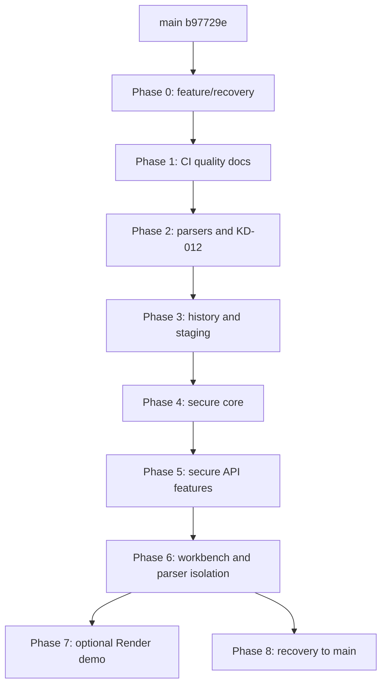

# Ревизия незамёрженных PR и план восстановления `main`

Документ подготовлен в режиме планирования: **код и PR не изменялись**.
Источник данных — SourceCraft MCP (`ListRepositoryPullRequests`,
`ListPullRequestFiles`) для `stammendrs1510/kd-checker`.

## 0. Резюме

| Показатель | Значение |
|------------|----------|
| Всего PR в репозитории | 96 (номера 1–98, где 14 и 21 — issues) |
| Смёржено в `main` | 31 |
| Отклонено (discarded) | 2 — #24, #31 |
| Незамёрженных | **63**: 18 open + 45 draft |
| Базовая точка `main` | `b97729e2451caad282240e181b959c70549a125f` |
| Текстовых конфликтов с `main` | **0** у всех 63 веток |
| PR с target ≠ `main` | **13** (#85–#98 частично) |
| PR, меняющих `app.py` / `storage.py` / `config.json` | **0** |

Главный вывод: риск восстановления — **не конфликты с `main`**, а:

1. длинная линейная цепочка зависимых веток (secure-платформа: 20+ PR);
2. отсутствие CI у части головных PR (помечены `[skip ci]` из-за квоты Actions);
3. несколько файловых коллизий между независимыми ветками;
4. локальные незакоммиченные артефакты стабилизации в рабочей копии.

Рекомендуемая стратегия: интеграционная ветка `feature/recovery` от
`b97729e` + последовательные merge по 6 фазам с чекпоинтами, затем
финальный переход в `main` слоями (3–4 PR), а не 63 отдельными merge.

## 1. Методика и ограничения

- Список PR выгружен полностью (`next_page_token` пуст), обрезания после #93 нет.
- Для 8 ключевых веток выгружен фактический список файлов с патчами:
  #23, #37, #38, #39, #40, #41, #44, #45, #46, #54, #72, #82, #83, #90.
- Для stacked-веток (в описании указано «изменения родителей включены в diff»)
  файловый состав приведён по описанию PR: diff содержит файлы родителей.
- Точные имена некоторых новых тестовых модулей в stacked-ветках не выгружались;
  это не влияет на порядок вливания, так как все они добавляют только новые файлы.
- Конфликты оценивались по пересечению файлов и по логическим зависимостям,
  без выполнения merge локально.

## 2. Полная инвентаризация 63 PR

Обозначения: `+` новый файл, `~` изменённый, `M` модуль, `К1–К5` — контуры КД
(см. раздел 3), `И` — инфраструктура.

### Группа A. Независимые от `main` (база `b97729e`), низкий риск

| PR | Название | Ветка | Файлы | Коды / модули | Контур | Конфликты и зависимости |
|----|----------|-------|-------|---------------|--------|-------------------------|
| #23 | Design: безопасное обновление сессии Checklist (#21) | `feature/checklist-session-renewal-design` | `+ design/__init__.py`, `+ design/checklist_session_model.py`, `+ docs/checklist-session-renewal-design.md`, `+ tests/test_checklist_session_design.py` | модель `Session`/`Reason`, EPLAN Checklist | И | нет; единственный PR, добавляющий `design/__init__.py` |
| #37 | docs: security and acceptance gates for multi-PC | `docs/multi-pc-security-gates` | `+ docs/multi-pc-security-gates.md` | G1–G7 | И | нет |
| #38 | test/docs: inventory FastAPI routes | `test/api-access-inventory` | `+ docs/api-access-inventory.md`, `+ tests/test_api_access_inventory.py` | 13 `/api` маршрутов, viewer/engineer/admin | И | нет; тест намеренно упадёт при любом новом локальном маршруте |
| #39 | chore: offline free-only development planner | `feature/free-only-development-controller` | `+ free_cycle.py`, `+ test_free_cycle.py`, `+ docs/free-only-development-controller.md` | планировщик задач, fail-closed | И | нет; `test_free_cycle.py` лежит в корне и не попадёт в `testpaths=tests` |
| #40 | fix: CSV — только первые 5000 записей | `fix/bounded-csv-reader` | `~ extractors.py`, `~ README.md`, `+ tests/test_csv_limits.py` | лимиты CSV, `KD-000` | И (парсеры) | `extractors.py` и `README.md` пересекаются с #41 |
| #41 | fix: PDF — не более 100 страниц | `fix/bounded-pdf-page-iteration` | `~ extractors.py`, `~ README.md`, `+ tests/test_pdf_reader_limits.py` | лимит страниц PDF | И (парсеры) | то же |
| #42 | test: целостность истории между процессами | `test/multiprocess-history-integrity` | `+ тест-модуль multiprocessing`, `+ docs` | транзакции, аудит | И (история) | нет |
| #43 | test: восстановление из резервной копии | `test/history-backup-restore` | `+ тест-модуль`, `+ docs` | restore, integrity/FK | И (история) | нет |
| #44 | feat(design): fail-closed access policy | `feature/isolated-access-policy` | `+ design/access_policy.py`, `+ docs/isolated-access-policy.md`, `+ tests/test_access_policy_design.py` | `Role`/`Action`/`Principal` | И (RBAC) | родитель #52; с #23 конфликта нет — `design/` дополняется аддитивно |
| #45 | feat: проверяемая копия истории | `feature/verified-history-copy` | `+ history_backup.py`, `+ docs/history-backup-tool.md`, `+ tests/test_history_backup.py` | SQLite backup API, schema v1 | И (история) | родитель #56 |
| #46 | quality: каталог доказательности правил | `test/rule-evidence-catalog-gate` | `+ quality/rule_catalog.py`, `+ docs/parallel-development-acceptance-plan.md`, `+ tests/test_rule_evidence_catalog.py` | 22 кода `KD-*` | И + все контуры | родитель #57; после #47 требует CON-коды в сканере |
| #48 | docs: master architecture roadmap | `docs/master-architecture-roadmap` | `+ docs/...` | направления A–G | И | нет |
| #49 | test: границы загрузки и скрытие исключений | `test/upload-boundary-contracts` | `+ тесты API 413/limits`, `+ docs` | лимиты загрузки | И | нет |
| #50 | test: инварианты идентичности и пар | `test/engineering-metamorphic-contracts` | `+ тесты run_scope/finding_identity/пар` | К2/К4, инварианты | К2, К4 | нет |
| #51 | test: инертные поля XLSX | `test/xlsx-report-snapshot-safety` | `+ тесты XLSX`, `+ docs` | экспорт | И | нет |
| #53 | test: инварианты исторических сравнений | `test/historical-comparison-invariants` | `+ тесты`, `+ docs` | история, Checklist | И | нет |
| #54 | test: матрица границ движка | `test/engine-rule-boundary-matrix` | `+ tests/test_engine_rule_boundary_matrix.py`, `+ docs/engine-rule-boundary-matrix.md` | `KD-001/002/003/004/005/010/011/012/020` | К1, К4 | совместим с #82 (проверено по содержимому теста) |
| #72 | ci: отмена устаревших прогонов PR | `ci/cancel-superseded-pr-runs` | `~ .github/workflows/tests.yml`, `+ docs/ci-compute-budget.md` | `concurrency` | И (CI) | `tests.yml` пересекается с #83 |
| #82 | fix: точное сопоставление ссылок спецификации | `feature/exact-specification-reference-matching` | `~ engine.py`, `+ document_reference.py`, `+ docs/specification-reference-matching.md`, `+ tests/test_document_reference.py`, `+ tests/test_specification_reference_integration.py` | `KD-012`, NFKC | К1 | меняет поведение `KD-012`; родитель #88 |
| #83 | quality: offline dependency contract | `quality/dependency-contract-guard` | `~ requirements.txt`, `~ .github/workflows/tests.yml`, `+ tools/dependency_policy.py`, `+ tests/test_dependency_policy.py`, `+ docs/dependency-policy.md` | сторож зависимостей и импортов | И (CI) | `requirements.txt` с #84; `tests.yml` с #72 |
| #88 | Reject numeric continuations in spec refs | `feature/kd-012-numeric-reference` | `~ document_reference.py`, `~ тесты` (по описанию) | `KD-012` | К1 | зависит от #82 |
| #90 | fix: Windows launcher preflight | `fix/windows-launcher-preflight` | `~ start_windows.bat` | проверка venv/import | И | конфликт с будущей итерацией 8 плана стабилизации |

### Группа B. Контур соединений

| PR | Название | Ветка | Файлы | Коды / модули | Контур | Конфликты и зависимости |
|----|----------|-------|-------|---------------|--------|-------------------------|
| #47 | feat: модель явных соединений | `feature/structured-connection-checks` | `+ connection_checks.py`, `+ тесты`, `+ docs`, `~ README.md` | `KD-CON-101`, `KD-CON-102` | К5 | требует #46/#57 для каталога; родитель #65 |
| #57 | fix: KD-CON в сканере каталога | `fix/connection-catalog-scanner` | `~ quality/rule_catalog.py`, `~ тест` (содержит #46) | `KD-CON` | К5 + И | зависит от #46 |

### Группа C. Scoped-история и офлайн-инструменты

| PR | Название | Ветка | Файлы | Модули | Контур | Конфликты и зависимости |
|----|----------|-------|-------|--------|--------|-------------------------|
| #55 | feat: tenant-scoped репозиторий истории | `feature/scoped-history-repository` | `+ scoped-репозиторий`, `+ новая схема в новом файле`, `+ тесты`, `+ docs` | org/project, audit, optimistic locking | И (история) | `storage.py` не изменяется; родитель #56/#58/#64/#66/#59 |
| #56 | feat: staging-импорт истории | `feature/staging-history-import` | `+ импортёр`, `+ тесты`, `+ docs` (содержит #45/#55) | legacy staging, manifest | И (история) | после #45 и #55; родитель #75/#76 |
| #58 | test: multiprocess scoped-истории | `test/scoped-history-multiprocess-acceptance` | `+ тест`, `+ docs` | транзакции | И | после #55 |
| #64 | test: цепочки аудита и restore | `test/scoped-audit-recovery-matrix` | `+ тест`, `+ docs` | аудит, FK | И | после #55 |
| #66 | quality: read-only аудит scoped-истории | `quality/scoped-audit-readonly-verifier` | `+ quality/...`, `+ тесты` | диагностика | И | после #55 |
| #75 | test: adversarial staging-импорт | `test/staging-import-adversarial-integrity` | `+ тест`, `+ docs` | импорт | И | после #56 |
| #76 | quality: preflight staging-импорта | `quality/staging-import-readonly-preflight` | `+ quality/...`, `+ тесты` | диагностика | И | после #56; родитель #77 |
| #77 | quality: сверка staged-строк с legacy | `quality/staging-row-reconciliation` | `+ quality/...`, `+ тесты` | диагностика | И | после #76 |

### Группа D. Ядро защищённой платформы

| PR | Название | Ветка | Файлы | Модули | Контур | Конфликты и зависимости |
|----|----------|-------|-------|--------|--------|-------------------------|
| #52 | feat: secure FastAPI + RBAC | `feature/secure-api-boundary` | `+ secure_sessions.py`, `+ secure_api.py`, `+ docs/secure-api-prototype.md`, `+ тесты` (содержит #44) | сессии, CSRF/Origin, 13 API | И (auth) | после #44 |
| #59 | feat: реальный защищённый backend | `feature/secure-real-backend` | `+ ScopedBackend`, `+ тесты` (содержит #44/#52/#55) | engine + scoped SQLite | И (auth) | после #52, #55, #47, #46 |
| #60 | feat: durable-сессии с межпроцессным revoke | `feature/durable-test-sessions` | `+ DurableSessions`, `+ тесты` (содержит #59) | server-local SQLite | И (auth) | после #59 |
| #61 | test: downgrade/revoke/Checklist 409 | `test/secure-e2e-revocation-acceptance` | `+ тесты`, `+ docs` | 401/403/409 | И | после #60 |
| #62 | test: adversarial protected uploads | `test/secure-http-adversarial-uploads` | `+ тесты`, `+ docs` | отказы без partial run | И | после #60 |
| #63 | test: матрица durable-сессий | `test/durable-sessions-failclosed-matrix` | `+ тесты`, `+ docs` | expiry/revoke/clock | И | после #60 |
| #74 | quality: preflight durable-сессий | `quality/durable-session-offline-preflight` | `+ quality/...`, `+ тесты` | диагностика | И | после #60 |

### Группа E. Защищённые API-функции

| PR | Название | Ветка | Файлы | Коды / модули | Контур | Конфликты и зависимости |
|----|----------|-------|-------|---------------|--------|-------------------------|
| #65 | feat: защищённый JSON API соединений | `feature/protected-connection-import` | `+ POST /api/connections/check`, `+ тесты`, `+ docs` (содержит #47/#59/#60) | `KD-CON-101/102` | К5 | после #47, #59, #60; родитель #67/#68 |
| #67 | test: негативный JSON и scoped HTTP | `test/connection-api-adversarial-acceptance` | `+ тест`, `+ docs` | контракт API | К5 | после #65 |
| #68 | feat: проектные настройки с версиями | `feature/project-config-audit` | `+ PUT /api/config`, `+ тесты` | config/version/audit | И | после #65; `config.json` не меняется |
| #69 | feat: приём HTTP-тела до парсинга | `feature/secure-body-budget` | `+ ASGI BodyBudget`, `+ тесты` | лимиты тела | И | после #68 |
| #70 | test: история конфигурации | `test/config-version-history-invariants` | `+ тест`, `+ docs` | конфиг | И | после #69 |
| #71 | test: границы body budget | `test/body-budget-boundary-matrix` | `+ тест`, `+ docs` | лимиты | И | после #69 |
| #73 | quality: аудит конфигурации | `quality/project-config-readonly-audit-verifier` | `+ quality/...`, `+ тесты` | диагностика | И | после #69 |
| #78 | test: два HTTP-инстанса | `test/two-instance-http-consistency` | `+ тест`, `+ docs` | консистентность | И | после #69 |
| #79 | test: изоляция трёх scope | `test/tenant-scope-http-replay-matrix` | `+ тест`, `+ docs` | изоляция tenant | И | после #69 |

### Группа F. Рабочее место и изоляция парсеров

| PR | Название | Ветка | Файлы | Модули | Контур | Конфликты и зависимости |
|----|----------|-------|-------|--------|--------|-------------------------|
| #80 | feat: русскоязычное рабочее место стенда | `feature/russian-secure-workbench` | `+ /workbench assets`, `+ /auth/context`, `+ тесты` | UI стенда, CSP | И | после #69; локальный UI не меняется |
| #81 | feat: процессная граница парсинга | `feature/parser-process-boundary` | `+ worker с timeout/RLIMIT/Job Object`, `+ тесты` | изоляция парсеров | И (парсеры) | после #80 |
| #84 | feat: синтетическая приёмка и TLS launcher | `feature/synthetic-acceptance-stand` | `+ synthetic_stand.py`, `+ тесты`, `+ docs` | CLI-приёмка | И | после #81; добавляет `starlette` в requirements |
| #85 | feat: снимок настроек и происхождения run | `feature/run-provenance-snapshot` | `+ снимок настроек`, `+ тесты`, `+ docs` | provenance | И | target = #84; после #84 |
| #86 | feat: общая квота parser-worker | `feature/shared-parser-capacity` | `+ file-lock quota`, `+ тесты` | квота | И (парсеры) | target = #85; после #85 |
| #87 | feat: отмена worker при disconnect | `feature/parser-disconnect-cancellation` | `+ cancellation`, `+ тесты` | отмена | И (парсеры) | target = #86; после #86 |

### Группа G. Приёмочные тесты PDF и Windows-worker

| PR | Название | Ветка | Файлы | Коды / модули | Контур | Конфликты и зависимости |
|----|----------|-------|-------|---------------|--------|-------------------------|
| #89 | test: реальный анализатор на синтетическом наборе | `test/kd-offline-pdf-acceptance` | `+ тест` | К2/К3, 4 замечания | К2, К3 | target = #87 |
| #91 | docs: offline PDF acceptance | `docs/kd-offline-acceptance` | `+ docs` | приёмка | И | target = #89 |
| #92 | fix: Windows parser worker bootstrap | `fix/windows-parser-worker-bootstrap` | `+ bootstrap`, `+ тесты` | Windows Job Object | И (парсеры) | target = #87 |
| #93 | test: четыре PDF через worker | `test/kd-parser-worker-pdf-bundle` | `+ тест` | К2, полный набор замечаний | К2 | target = #92 |
| #94 | feat: KD-PE-100 evidence v1 | `feature/kd-pe-100-evidence-v1` | `+ evidence v1/v2`, `+ тесты` | `KD-PE-100` | К2 | target = #93 |

### Группа H. Демонстрационный стенд Render (не продукт `main`)

| PR | Название | Ветка | Файлы | Модули | Контур | Конфликты и зависимости |
|----|----------|-------|-------|--------|--------|-------------------------|
| #95 | feat: защищённое PDF-демо для Render Free | `feature/render-free-pdf-demo` | `+ отдельное FastAPI-приложение`, `+ render.yaml`, `+ тесты` | Basic-auth, in-memory история | И (демо) | target = #93 |
| #96 | ci: gated Ubuntu-прогон для #95 | `ci/render-pr95-linux-acceptance` | `+ workflow`, метка `run-render-pr95-linux` | CI | И | target = #95 |
| #97 | fix: Origin для form POST | `fix/render-demo-form-origin` | `~ демо-приложение`, `+ тесты` | `same-origin` | И | target = #95 |
| #98 | ci: gated Ubuntu-прогон для #97 | `ci/render-pr97-linux-acceptance` | `+ workflow`, метка `run-render-pr97-linux` | CI | И | target = #97 |

## 3. Привязка к 5 контурам КД

Трактовка контуров принята по документу `quality/rule_catalog.py` и
`docs/parallel-development-acceptance-plan.md`. Если у команды другая
таксономия — таблицу нужно пересобрать, порядок вливания от этого не меняется.

| Контур | Коды | Открытые PR |
|--------|------|-------------|
| К1. Обозначения и спецификации | `KD-001`, `KD-010`, `KD-012` | #82, #88, #54 |
| К2. Э3 ↔ ПЭ3 | `KD-PE-000/100/101/102/103/104` | #93, #94, #89, #91, #50 |
| К3. Комплектность и состав | `KD-SET-101/102/103/201/202/203` | новых правил нет; #89 проверяет полный набор |
| К4. Дубли и идентичность документов | `KD-011`, `KD-020`, `KD-PE-104`, `KD-SET-102` | #50, #54 |
| К5. Соединения, кабели, клеммы | `KD-CON-101/102` | #47, #65, #67 |
| Инфраструктура | — | остальные 50+ PR (auth/tenancy, история, парсеры, CI, docs) |

Важно: **ни один незамёрженный PR не добавляет новых кодов замечаний**,
кроме уже заявленных `KD-CON-101/102` в #47. #94 расширяет evidence для
существующего `KD-PE-100`, не меняя его уровень.

## 4. Матрица конфликтов

### 4.1 С `main` (`b97729e`)

Текстовых конфликтов нет: все 63 ветки основаны на `b97729e` или его потомках.
Единственный риск — **локальная рабочая копия**: в ней уже присутствуют
`pyproject.toml`, `.gitattributes`, `plans/`, `docs/stabilization-baseline.md`,
которых нет в `main`. Их нужно зафиксировать отдельным коммитом/веткой до
начала интеграции, иначе они смешаются с merge-коммитами и исказят baseline.

### 4.2 Между PR

| Файл / область | Пересечение | Тип | Действие |
|----------------|-------------|-----|----------|
| `extractors.py` | #40 + #41 | текстовая (одинаковая вставка `from itertools import islice`) | merge последовательно, проверить отсутствие дубля импорта |
| `README.md` | #40 + #41 (+ возможно #47) | разные ханки | merge последовательно, при необходимости ручная правка |
| `.github/workflows/tests.yml` | #72 + #83 | разные ханки (верх / шаг установки) | merge #83, затем #72 |
| `requirements.txt` | #83 + #84 | вероятная коллизия в верхнем блоке | merge #83, затем #84; `python tools/dependency_policy.py` |
| `start_windows.bat` | #90 ↔ итерация 8 стабилизации | логическая | решить: принять #90 и переписать в итерации 8, либо отложить #90 |
| `design/` | #23 (`__init__.py`) + #44 (`access_policy.py`) | аддитивная | конфликта нет, порядок любой |
| `quality/` | #46, #57, #66, #73, #74, #76, #77 | возможный add/add `quality/__init__.py` | проверить при первом merge; иначе namespace package |
| `engine.py` | #82 (единственный) | нет | #54 тесты совместимы с новым поведением |
| `app.py`, `storage.py`, `config.json`, `static/index.html` | никто из 63 | нет | локальный MVP не затрагивается |
| `tests/` | все тестовые PR | уникальные имена файлов | конфликтов нет |

### 4.3 Логические (не файловые) зависимости

1. `quality/rule_catalog.py`: #46 → #57 → #47. Без #57 после #47 тест
   `observed == RULES - staged` упадёт, потому что `connection_checks.py`
   появится, а сканер не увидит `KD-CON`.
2. `#38` (инвентарь 13 маршрутов) сломается, если итерация 7 стабилизации
   добавит `GET /api/health` в `app.py`. Согласовать: сначала health, затем
   обновить инвентарь, либо наоборот.
3. `#83` (dependency policy) должен проходить после каждого merge:
   #84 добавляет `starlette`, #95 может добавить зависимости демо.
4. `#85`, #86, #87, #88, #89, #91, #92, #93, #94, #95, #96, #97, #98 имеют
   target ≠ `main`. Без retarget их merge принесёт в `main` всю родительскую
   цепочку как «чужие» изменения.
5. `#59` требует уже влитых #47 и #55; `#65` — #47 и #59/#60; `#68` — #65;
   `#69` — #68; `#80` — #69; `#81` — #80; #84–#87 — строго последовательно.

## 5. Merge Roadmap

Стратегия: `feature/recovery` от `b97729e`, merge (не cherry-pick) каждой
ветки после retarget на интеграционную ветку, полный прогон после каждого
блока. Cherry-pick не рекомендуется для stacked-цепочек: он теряет
родительские коммиты и порождает повторные конфликты. Squash допустим только
для одиночных docs/test PR.

### Phase 0. Подготовка

1. Зафиксировать локальные артефакты стабилизации отдельным коммитом/веткой.
2. Создать `feature/recovery` от `b97729e`.
3. Включить CI на push в `feature/recovery` (иначе каждый merge непроверяем).
4. Подтвердить остаток квоты GitHub Actions: у #80, #81, #84–#87 CI пропущен
   через `[skip ci]`, зелёный статус для них отсутствует.

### Phase 1. Качество, CI и документация (без runtime)

| Шаг | PR | Действие | Зачем именно здесь |
|-----|----|----------|--------------------|
| 1 | #83 | retarget → merge | вводит `pydantic` и сторож импортов; все последующие merge должны его проходить |
| 2 | #72 | retarget → merge | меняет тот же `tests.yml`, что и #83; после #83 |
| 3 | #46 | merge | каталог 22 кодов, база для #57 |
| 4 | #57 | retarget после #46 → merge | добавляет `KD-CON` в сканер до появления `connection_checks.py` |
| 5 | #38 | merge | фиксирует 13 маршрутов, пока локальный API не менялся |
| 6 | #37 | merge | gates G1–G7 |
| 7 | #48 | merge | мастер-план A–G |
| 8 | #39 | merge | офлайн-планировщик |
| 9 | #23 | merge | design-модель сессии Checklist |
| 10 | #44 | merge | design-политика доступа, родитель #52 |

Чекпоинт: `pytest -q`, `python tools/dependency_policy.py`, `git diff --check`.

### Phase 2. Парсеры и правила обозначений (локальный runtime)

| Шаг | PR | Действие | Зачем именно здесь |
|-----|----|----------|--------------------|
| 11 | #40 | merge | лимит CSV; первым, чтобы #41 наложился на готовый импорт |
| 12 | #41 | merge | лимит страниц PDF; проверить дубль `islice` |
| 13 | #82 | merge | меняет `KD-012`; единственная правка `engine.py` |
| 14 | #88 | retarget после #82 → merge | уточняет числовые продолжения ссылок |
| 15 | #90 | merge | preflight Windows-лаунчера |

Чекпоинт: полный `pytest` + UI, отдельно `tests/test_engine_rule_boundary_matrix.py`
из #54 (совместимость с #82 подтверждена по содержимому теста).

### Phase 3. История, бэкап и staging (новые файлы, `storage.py` не меняется)

| Шаг | PR | Действие | Зачем именно здесь |
|-----|----|----------|--------------------|
| 16 | #45 | merge | offline backup, родитель #56 |
| 17 | #55 | merge | scoped-репозиторий, родитель #56/#58/#64/#66/#59 |
| 18 | #56 | retarget → merge | staging-импорт, содержит #45/#55 |
| 19 | #75 | merge | adversarial staging |
| 20 | #76 | merge | preflight импорта |
| 21 | #77 | merge | сверка staged-строк |
| 22 | #58 | merge | multiprocess scoped-истории |
| 23 | #64 | merge | цепочки аудита и restore |
| 24 | #66 | merge | read-only аудит scoped-истории |

Чекпоинт: `PRAGMA integrity_check`/`foreign_key_check` в тестах, multiprocess
на Linux и Windows.

### Phase 4. Ядро защищённой платформы (строго последовательно)

| Шаг | PR | Действие | Зачем именно здесь |
|-----|----|----------|--------------------|
| 25 | #52 | retarget → merge | secure factory, содержит #44 |
| 26 | #59 | retarget → merge | реальный backend, требует #52/#55/#47 |
| 27 | #60 | retarget → merge | durable-сессии, содержит #59 |
| 28 | #61 | merge | downgrade/revoke/409 |
| 29 | #62 | merge | adversarial uploads |
| 30 | #63 | merge | матрица durable-сессий |
| 31 | #74 | merge | preflight durable-сессий |

Чекпоинт: 401/403/IDOR/CSRF/revoke, отсутствие partial run.

### Phase 5. Защищённые API-функции

| Шаг | PR | Действие | Зачем именно здесь |
|-----|----|----------|--------------------|
| 32 | #65 | retarget → merge | connection API, содержит #47/#59/#60 |
| 33 | #67 | merge | негативный JSON |
| 34 | #68 | retarget → merge | config/version/audit |
| 35 | #69 | retarget → merge | BodyBudget |
| 36 | #70 | merge | история конфигурации |
| 37 | #71 | merge | границы body budget |
| 38 | #73 | merge | аудит конфигурации |
| 39 | #78 | merge | два инстанса |
| 40 | #79 | merge | изоляция трёх scope |

### Phase 6. Рабочее место, изоляция парсеров и приёмка

| Шаг | PR | Действие | Зачем именно здесь |
|-----|----|----------|--------------------|
| 41 | #80 | retarget → merge | workbench поверх #69 |
| 42 | #81 | retarget → merge | процессная граница парсинга |
| 43 | #84 | retarget → merge | синтетический стенд и TLS launcher |
| 44 | #85 | retarget на `feature/recovery` → merge | provenance, target сейчас #84 |
| 45 | #86 | retarget → merge | квота worker, target сейчас #85 |
| 46 | #87 | retarget → merge | отмена по disconnect, target сейчас #86 |
| 47 | #92 | retarget → merge | Windows bootstrap, target сейчас #87 |
| 48 | #93 | retarget → merge | четыре PDF через worker |
| 49 | #94 | retarget → merge | evidence v1 для `KD-PE-100` |
| 50 | #89 | retarget → merge | реальный анализатор на синтетике |
| 51 | #91 | retarget → merge | документация приёмки |

Чекпоинт: полный набор + worker parity + timeout/disconnect + Windows-прогон
(Job Object фактически не проверялся ни в одном PR).

### Phase 7. Демонстрационный стенд Render — отдельно от `main`

#95 → #97 → #96/#98. Это самостоятельное приложение с Basic-auth и
in-memory историей, не часть локального MVP. Рекомендация: **не вливать в
`main`** в рамках восстановления; держать в отдельной ветке/репозитории демо
до отдельного решения владельца.

### Phase 8. Переход `feature/recovery` → `main`

Предпочтительно не одним гигантским PR, а 3–4 последовательными PR по слоям:

1. **R1. Quality/CI/docs + парсеры + `KD-012`**: Phase 1–2.
2. **R2. История и staging**: Phase 3.
3. **R3. Secure core + API**: Phase 4–5.
4. **R4. Workbench + parser isolation + приёмка**: Phase 6.

Каждый PR в `main`: полный CI на Windows и Linux, `python tools/dependency_policy.py`,
ручная Windows-приёмка по `docs/windows-acceptance-smoke.md`, проверка
`git status --porcelain`.

## 6. Правила приёмки и запреты

- Не мержить в `main` PR с target ≠ `main` без retarget и повторного CI:
  иначе в `main` попадёт вся родительская цепочка.
- Не мержить #47 без #57: гарантированное падение каталога доказательности.
- Не мержить #59 без #52 и #55; #65 без #47 и #59/#60; #68 без #65;
  #69 без #68; #80 без #69; #81 без #80; #84–#87 строго по порядку.
- Не считать зелёным PR, у которого CI пропущен через `[skip ci]`
  (#80, #81, #84–#87): нужен прогон на интеграционной ветке.
- Не смешивать восстановление PR с итерациями стабилизации в одном PR:
  конфликты `start_windows.bat`, `app.py` (`/api/health`) и `requirements.txt`
  станут неразрешимыми для ревью.
- Не переносить решения инженера и не менять формат CSV/XLSX при merge:
  все PR это соблюдают, но проверить на чекпоинтах.
- Все тестовые документы — синтетические; реальные КД, токены Supabase и
  enterprise-данные в ветках отсутствуют.

## 7. Что осталось непроверенным

| Пункт | Причина |
|-------|---------|
| CI для #80, #81, #84, #85, #86, #87 | пропущен `[skip ci]` из-за квоты Actions |
| Windows Job Object / ACL / file-lock | реализовано, но не запускалось на Windows |
| Два физических ПК, LAN, PostgreSQL | вне границ всех PR; gates G1–G7 не выполнены |
| Реальный Supabase/EPLAN Checklist | только синтетика и mock-транспорт |
| Точные имена тестовых файлов stacked-веток | не выгружались; на порядок merge не влияют |
| `quality/__init__.py` add/add | нужно проверить при первом merge группы C/E |

## 8. Итоговая рекомендация

1. Принять `feature/recovery` как единственную точку сборки; `main` не трогать
   до прохождения Phase 1–3.
2. Сначала влить «дешёвый» слой: #83, #72, #46, #57, #38, #37, #48, #39, #23, #44.
3. Затем локальный runtime: #40, #41, #82, #88, #90.
4. Затем историю: #45, #55, #56, #75, #76, #77, #58, #64, #66.
5. Затем secure-цепочку: #52, #59, #60, #61–#63, #74, #65, #67–#71, #73, #78–#81.
6. Приёмку PDF/worker: #84–#87, #92–#94, #89, #91.
7. Render-демо #95–#98 оставить вне `main`.
8. Перейти в `main` четырьмя PR по слоям с полным Windows/Linux CI и ручной
   приёмкой.
