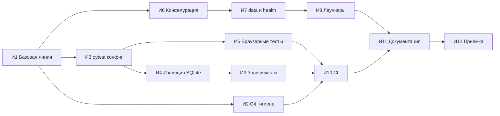

# План стабилизации репозитория kd-checker

## 1. Контекст и границы аудита

Проверено статически, без запуска кода:

- дерево рабочей копии совпадает с деревом `main` GitHub-репозитория
  `stammendr1510-oss/KD-Checker` на коммите `b97729e2451caad282240e181b959c70549a125f`;
- все локальные импорты разрешаются: 18 runtime-модулей
  (`app`, `engine`, `extractors`, `kd_crosscheck`, `storage`, `issue_tracking`,
  `excel_reports`, `set_completeness`, `full_set_completeness`,
  `document_identity`, `pair_analysis`, `run_comparison`, `checklist_run`,
  `checklist_snapshot`, `checklist_supabase`, `checklist_comparison`,
  `checklist_diff_csv`, `checklist_diff_xlsx`);
- 26 тестовых модулей присутствуют, ссылки в `README.md` и `docs/*.md`
  ведут на существующие файлы;
- отсутствующих модулей и «битых» импортов на уровне исходников не найдено.

Вывод аудита: нестабильность вызывают не утерянные исходники, а
**необъявленные локальные зависимости и отсутствующая инфраструктура сборки**:
`.venv`, браузер Chromium для Playwright, `data/history.sqlite3`,
перезаписываемый `config.json`, запуск тестов только из корня через
`python -m pytest`.

### Что НЕ входит в план

- изменение алгоритмов проверки КД (`engine.py`, `kd_crosscheck.py`,
  `full_set_completeness.py`);
- изменение схемы SQLite, форматов CSV/XLSX и существующих кодов замечаний;
- объединение открытого PR #23 (`design/`, `docs/checklist-session-renewal-design.md`);
- реальные запросы в Supabase/EPLAN Checklist и реальные документы предприятия.

## 2. Сводка находок

| ID | Проблема | Влияние | Итерация |
|----|----------|---------|----------|
| F1 | Нет `pyproject.toml`/`conftest.py`; `sys.path` правится только в `tests/test_engine.py` | `pytest` из корня падает на `import app`, работает только `python -m pytest` | И3 |
| F2 | Нет `.gitignore` и `.gitattributes` | в коммит могут попасть `data/`, `*.sqlite3`, `*.bak`, `.venv`, `__pycache__`; EOL bat/py не зафиксированы | И2 |
| F3 | `tests/test_issue_ui.py` импортирует Playwright на уровне модуля и запускает Chromium без проверки | collection error или падение на машине без браузера | И5 |
| F4 | Нет глобальной изоляции `storage.DB` в тестах | риск записи в реальный `data/history.sqlite3` | И4 |
| F5 | `PUT /api/config` перезаписывает tracked `config.json`; `load_cfg()` падает при отсутствии/повреждении файла | грязный git, невозможность откатить defaults, 500 без диагностики | И6 |
| F6 | `data/` создаётся неявно в `storage.connect()`; нет health-check и проверки writability | неясные ошибки на read-only каталоге, гонка при старте | И7 |
| F7 | `start_windows.bat` не проверяет Python, не обновляет зависимости, не задаёт UTF-8, открывает браузер до готовности; нет unix-лаунчера | «не запускается» на чистой машине, обещанная кроссплатформенность не выполнена | И8 |
| F8 | Нет фиксации версий зависимостей и `pip check`; приватные импорты `_format_sheet`/`_text` между модулями | невоспроизводимая сборка, хрупкая связность модулей | И9 |
| F9 | CI только на `pull_request`; быстрые и браузерные тесты в одном job | `main` не проверяется, падение браузера блокирует unit-контур | И10 |
| F10 | Версия расходится: README «MVP 0.1», `app.py` 0.2.0, UI «MVP 0.2»; нет `.env.example` | путаница при приёмке, скрытые переменные окружения | И11 |
| F11 | Нет единого протокола приёмки «чистая машина» | невозможно доказать, что репозиторий собирается без локальных файлов | И12 |

## 3. Порядок итераций

Правила выполнения: одна итерация — один PR; каждая итерация завершается
прогоном `pytest -q -m "not ui"` и не меняет инженерные алгоритмы; все
тестовые документы синтетические.

---

## Итерация 1. Базовая линия

**Цель.** Зафиксировать исходное состояние, чтобы сравнивать с ним каждый шаг.

**Файлы.** `docs/stabilization-baseline.md` — новый.

**Критерий готовности.**
- `git rev-parse HEAD` совпадает с `b97729e2451caad282240e181b959c70549a125f`;
- в документ записаны результаты `python -m pytest -q` и
  `python -m pytest -q -m "not ui"` с числом passed/skipped/failed;
- `python -c "import app; print(app.app.version)"` выводит `0.2.0`;
- перечислены локальные артефакты, отсутствующие в git: `.venv`, Chromium,
  `data/history.sqlite3`, `config.local.json`.

## Итерация 2. Git-гигиена

**Цель.** Исключить попадание локального состояния и секретов в коммиты,
зафиксировать переводы строк.

**Файлы.** `.gitignore` — новый, `.gitattributes` — новый.

**Критерий готовности.**
- `git check-ignore -v data/history.sqlite3` и `git check-ignore -v .venv`
  срабатывают;
- после `python app.py` и полного прогона тестов `git status --porcelain` пуст;
- `git ls-files --eol` показывает `w/crlf` для `start_windows.bat` и `w/lf`
  для `*.py` и `*.sh`;
- в `.gitignore` есть `data/`, `*.sqlite3*`, `*.bak`, `.env`,
  `config.local.json`, `.venv/`, `__pycache__/`, `.pytest_cache/`,
  `test-results/`, `playwright-report/`.

## Итерация 3. Конфигурация pytest и импорты без зависимости от CWD

**Цель.** Сделать тесты запускаемыми из любого каталога одним источником
настроек, убрать ручной `sys.path`.

**Файлы.** `pyproject.toml` — новый; `tests/test_engine.py` — удалить
`sys.path.insert`.

**Критерий готовности.**
- в `pyproject.toml` заданы `[tool.pytest.ini_options]` с `testpaths`,
  `pythonpath = ["."]`, `addopts = "-ra"`, маркер `ui`;
- `pytest --collect-only -q` из корня и из `tests/` даёт одинаковое число
  тестов и 0 ошибок;
- `pytest -q -m "not ui"` проходит без `python -m`;
- `grep -R "sys.path" tests/` ничего не находит.

## Итерация 4. Изоляция тестов от реальной SQLite

**Цель.** Гарантировать, что ни один тест не пишет в `data/history.sqlite3`,
даже если забыл `monkeypatch`.

**Файлы.** `tests/conftest.py` — новый; при необходимости убрать дублирующие
patch-и из `tests/test_issue_management.py`, `tests/test_acceptance_smoke.py`.

**Критерий готовности.**
- autouse-фикстура подменяет `storage.DB` на `tmp_path / "history.sqlite3"`;
- после полного прогона каталог `data/` не создан;
- тест без собственного `monkeypatch` использует временную БД;
- все тесты зелёные, `git status --porcelain` пуст.

## Итерация 5. Браузерные тесты как отдельный опциональный контур

**Цель.** Убрать жёсткую зависимость от локального Chromium: без браузера
тесты должны корректно пропускаться, а не ломать сбор.

**Файлы.** `tests/test_issue_ui.py`, `tests/conftest.py`, `pyproject.toml`.

**Критерий готовности.**
- Playwright импортируется через `pytest.importorskip` с понятной причиной;
- при отсутствии браузера тесты получают `skip`, а не `error`, код выхода 0;
- при `KD_TEST_CHROMIUM` с несуществующим путём выводится явная причина;
- `pytest -q -m "not ui"` не импортирует Playwright вообще;
- в CI с установленным Chromium тесты проходят.

## Итерация 6. Конфигурация: defaults в git, локальные правки вне git

**Цель.** Отделить поставляемые настройки от пользовательских, исключить
порчу tracked-файла и невнятные 500.

**Файлы.** `app.py`, `config.json`, `.gitignore`, `README.md`,
`docs/issue-management.md`, `tests/test_config_defaults.py` — новый.

**Критерий готовности.**
- `config.json` — только defaults, доступен только на чтение;
- `config.local.json` — необязательные override-ы, создаётся `PUT /api/config`
  атомарно, игнорируется git;
- `load_cfg()` объединяет defaults и override-ы и валидирует все ключи;
- повреждённый `config.local.json` даёт HTTP 500 с именем файла и причиной,
  сервер остаётся работоспособным;
- удаление `config.local.json` возвращает defaults;
- сохранение настроек через UI не меняет `git status`;
- новый тест покрывает merge, override, невалидный JSON.

## Итерация 7. Каталог данных, writability и health-check

**Цель.** Явно готовить хранилище при старте и дать проверяемый признак
готовности вместо ожидания «на глаз».

**Файлы.** `storage.py`, `app.py`, `tests/test_health.py` — новый,
`docs/windows-acceptance-smoke.md`.

**Критерий готовности.**
- `storage.init_storage()` создаёт `data/`, проверяет запись пробным файлом и
  бросает типизированную ошибку с путём и причиной;
- `GET /api/health` возвращает `status`, `version`, `db_path`, `db_writable`;
- на каталоге только для чтения health отвечает 503 с безопасным текстом,
  трассировка не уходит клиенту;
- smoke-тест и лаунчер используют health вместо фиксированной паузы;
- тесты покрывают успешный и read-only сценарии.

## Итерация 8. Кроссплатформенные лаунчеры

**Цель.** Запуск «двойным щелчком» и из консоли без ручной подготовки
окружения и без гонки с открытием браузера.

**Файлы.** `start_windows.bat`, `start.sh` — новый, `README.md`,
`docs/windows-acceptance-smoke.md`.

**Критерий готовности.**
- Windows-скрипт: `chcp 65001`, поиск `py -3.12` → `py -3` → `python`,
  проверка версии ≥ 3.11, создание `.venv`, установка зависимостей при
  первом запуске или изменении `requirements.txt`, ожидание health до 60 с,
  затем открытие браузера; при ошибке — понятное сообщение и код ≠ 0;
- unix-скрипт: `set -euo pipefail`, те же проверки, ожидание health,
  опциональное открытие браузера;
- проверено на пути с пробелами и кириллицей;
- повторный запуск не переустанавливает зависимости без необходимости.

## Итерация 9. Воспроизводимость зависимостей и чистота импортов

**Цель.** Сборка не зависит от «удачного» разрешения версий, модули не
держатся за приватные имена друг друга.

**Файлы.** `requirements.txt`, `requirements-dev.txt`, `excel_reports.py`,
`checklist_diff_xlsx.py`, `app.py`.

**Критерий готовности.**
- прямые зависимости зафиксированы точными версиями; при необходимости
  добавлен constraints-файл для транзитивных;
- `pip check` не находит конфликтов;
- `python -c "import app"` работает на окружении только с runtime-зависимостями;
- `_format_sheet` и `_text` переименованы в публичные `format_sheet` и
  `text_cell`, приватных импортов между модулями нет;
- `python -m compileall -q .` без ошибок, `pytest -q -m "not ui"` зелёный.

## Итерация 10. CI: покрытие main, разделение контуров

**Цель.** Проверять `main` на каждый push и не блокировать быстрые тесты
браузерным контуром.

**Файлы.** `.github/workflows/tests.yml`.

**Критерий готовности.**
- триггеры: `pull_request` в `main`, `push` в `main`, `workflow_dispatch`;
- job `unit`: Python 3.11 и 3.13 на Ubuntu и Windows, `pip check`,
  `python -m compileall -q .`, `pytest -q -m "not ui"`;
- job `ui`: Python 3.13, установка Chromium, `pytest -q -m ui`;
- у job заданы `timeout-minutes`, при падении выгружаются артефакты;
- искусственно сломанный импорт валит job `unit`;
- оба job зелёные на `main`.

## Итерация 11. Документация, версия и переменные окружения

**Цель.** Единый источник правды по версии, запуску и опциональным
интеграциям; отсутствие скрытых настроек.

**Файлы.** `README.md`, `app.py`, `static/index.html`, `docs/*.md`,
`.env.example` — новый.

**Критерий готовности.**
- версия совпадает в `app.py`, UI и README; строки «MVP 0.1» нет;
- в README указаны Python 3.11+, локальные артефакты, `config.local.json`,
  `/api/health`, команды `pytest` и `python -m pytest`;
- `.env.example` содержит все пять переменных из `checklist_run.py` с
  комментариями и пустыми значениями;
- в репозитории нет реальных ключей `sb_publishable_` и JWT;
- все внутренние ссылки в документации разрешаются.

## Итерация 12. Финальная приёмка на чистой машине

**Цель.** Доказать, что репозиторий собирается и работает без локальных
файлов, оставшихся от прежних установок.

**Файлы.** `docs/stabilization-verification.md` — новый,
`docs/windows-acceptance-smoke.md`.

**Критерий готовности.**
- протокол выполнен на Windows 11 и Linux на чистом клоне без `.venv`,
  `data/` и Chromium;
- шаги: установка зависимостей → `pytest -m "not ui"` → `pytest -m ui` при
  наличии браузера → `python app.py` → `GET /api/health` → smoke-тест
  `tests/test_acceptance_smoke.py` → загрузка синтетического PDF через UI →
  выгрузка CSV и XLSX → повторный запуск;
- `git status --porcelain` пуст, вне `data/` новых файлов нет;
- результат прогона приложен к PR.
